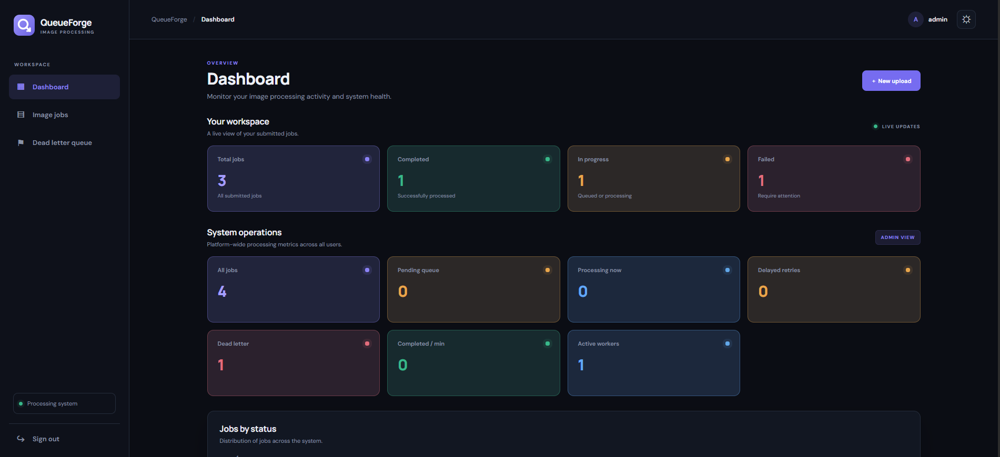
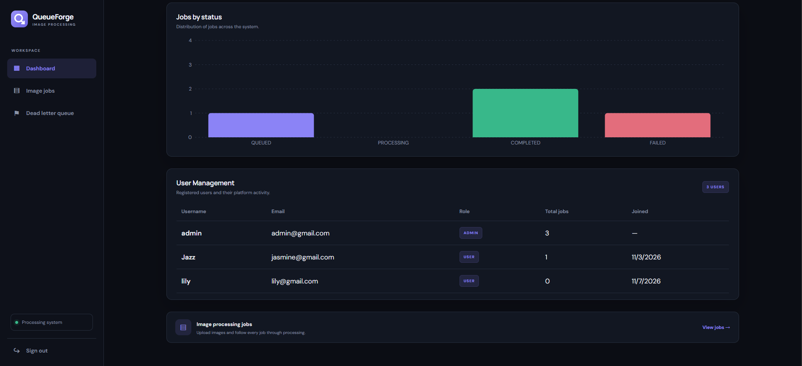
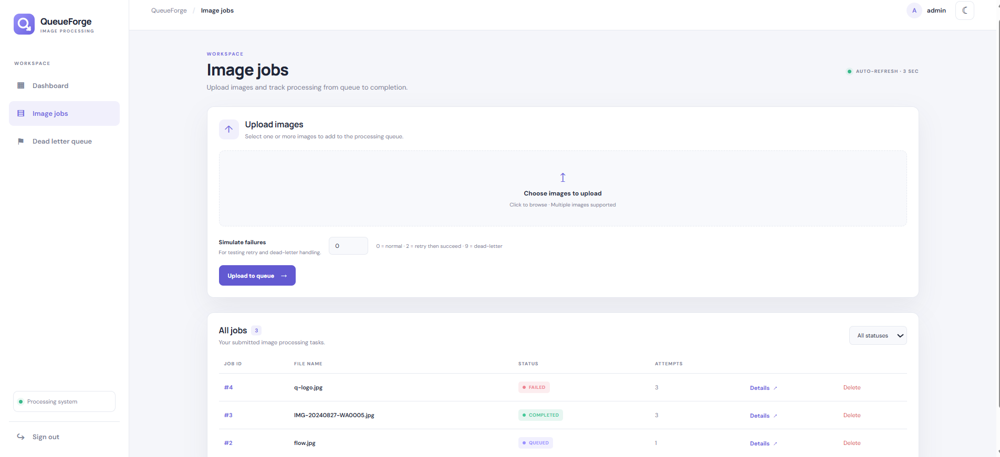
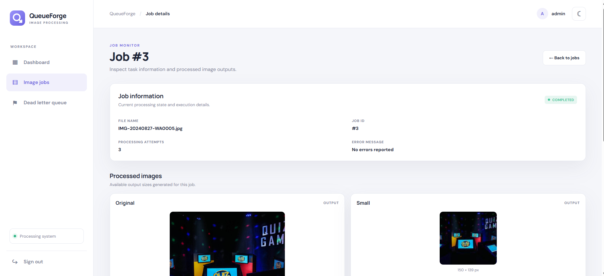
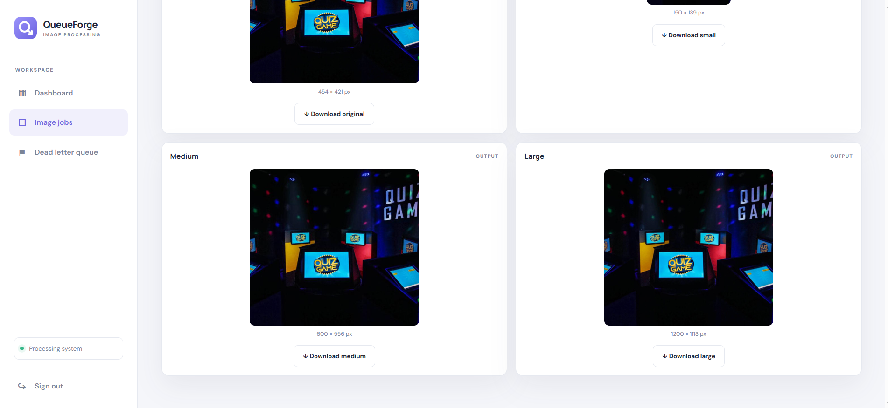
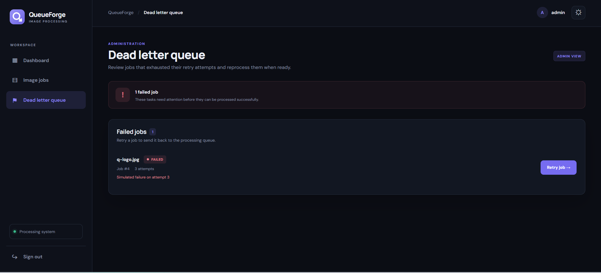

# QueueForge – Frontend

The frontend for **QueueForge**, a distributed job queue system with an image processing pipeline. Built using React and Vite, it provides an interface for users to submit image processing jobs, monitor their progress, and view generated image outputs. It also includes an admin interface for monitoring queue activity and managing failed jobs.

## Live Application

- **Frontend:** https://queue-forge.netlify.app/
- **Backend API:** https://queueforge-backend-2pzl.onrender.com
- **Backend Repository:** https://github.com/hannahrajapaga-web/queueforge

## Features

- **User Authentication:** Login and signup with JWT-based authentication.
- **Role-Based Access:** Separate access for regular users and administrators.
- **Dashboard:** View job activity and processing statistics.
- **Job Submission:** Upload images and submit image processing jobs.
- **Job Tracking:** Monitor job statuses and view individual job details.
- **Image Previews:** View original images and generated output variants.
- **Multiple Image Sizes:** Supports original, small, medium, and large image outputs.
- **Admin Dashboard:** Monitor overall system activity through statistics and charts.
- **Dead Letter Queue:** View jobs that have exhausted their retry attempts.
- **Automatic Status Updates:** Job details are periodically refreshed to display the latest processing status.

## Screenshots

The following screenshots demonstrate the application's administrative and image-processing interfaces. Admin-only screens are included for demonstration purposes.

### Admin Dashboard

**Dashboard – Overview (Dark Mode)**



**Dashboard – Additional Metrics (Dark Mode)**



### Image Processing

**Image Jobs (Light Mode)**



**Image Job Details – Overview (Light Mode)**



**Image Job Details – Generated Outputs (Light Mode)**



### Dead Letter Queue

**Failed Jobs and Dead Letter Queue (Dark Mode)**



## Technology Stack

- **Frontend Framework:** React.js
- **Build Tool:** Vite
- **Language:** JavaScript
- **Routing:** React Router DOM
- **HTTP Client:** Axios
- **Charts:** Recharts
- **Styling:** CSS

## Getting Started

### Prerequisites

- Node.js
- npm
- QueueForge backend running locally or accessible through the deployed API.

### Installation

1. Clone the repository:

   ```bash
   git clone https://github.com/hannahrajapaga-web/queueforge-ui.git
   ```

2. Navigate to the project directory:

   ```bash
   cd queueforge-ui
   ```

3. Install dependencies:

   ```bash
   npm install
   ```

4. Configure the frontend API connection to point to your running QueueForge backend.

5. Start the development server:

   ```bash
   npm run dev
   ```

6. Open the local URL displayed in the terminal (Vite typically uses `http://localhost:5173`).

## Backend

The frontend communicates with the QueueForge Spring Boot backend, which handles authentication, job submission, queue processing, image storage, and job management.

**Backend Repository:** https://github.com/hannahrajapaga-web/queueforge

## Deployment

- **Frontend Hosting:** Netlify
- **Backend Hosting:** Render
- **Database:** Aiven MySQL
- **Queue:** Aiven Valkey (Redis-compatible)

The first request to the hosted application may take approximately 10–15 seconds if the backend needs to wake up after inactivity.

---

**QueueForge – Distributed Job Queue System with Image Processing Pipeline**